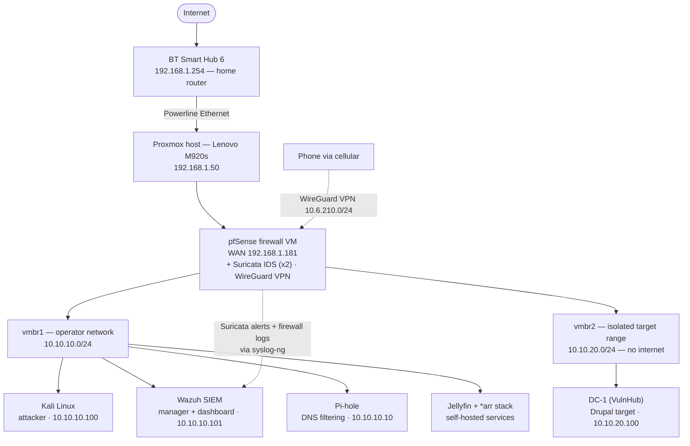

# SOC Detection Lab — Building and Testing a Detection Pipeline (pfSense · Suricata · Wazuh)

A home security-operations lab: network segmentation, custom IDS rules, and a Wazuh SIEM — then a full attack against a live target to measure what the monitoring actually catches and misses.

**Skills demonstrated:** network segmentation · IDS/IPS (Suricata) · SIEM engineering (Wazuh) · detection engineering & custom rules · log pipeline design (syslog-ng) · MITRE ATT&CK mapping · attack simulation · defensive analysis & reporting.

**Jump to:** [Architecture](#how-its-laid-out) · [Build phases](#what-i-built-and-verified) · [The detection exercise](#phase-11--the-detection-exercise) · [Reports](#reports) · [Limitations](#honest-limitations)

This started as a way to get hands-on with the things a course can't really teach — segmenting a network, writing IDS rules, wiring detections into a SIEM, breaking and fixing a VPN, and watching an attack light up (or slip past) my own monitoring in real time. It ended up as a working detection stack that I then attacked end to end, from first scan to root, and analysed from the defender's side.

Everything runs on a single Lenovo ThinkCentre M920s (i5-8500, 24 GB RAM) under Proxmox. The lab is walled off from my home network behind pfSense, watched by Suricata on two segments, filtered by Pi-hole, aggregated into a Wazuh SIEM, and reachable remotely over WireGuard. A deliberately vulnerable target sits on its own isolated segment, and I attack it from a separate Kali box.

> Private, isolated lab built for learning. No keys, tokens, or live configs are committed — just documentation and screenshots. Internal `10.x` / `192.168.x` addresses are shown because they're private and help explain the topology.

## Why I built it

I wanted a realistic environment to practise both sides — defending a network and attacking it — and to actually *prove* things work instead of assuming they do. Every phase ends with a verification step: a scan that fires an alert, a ping that gets blocked, a DNS lookup that gets sinkholed, an exploit that trips a signature. The final phase is the point of the whole thing: a real intrusion, reconstructed from the sensors, to find out exactly where the monitoring succeeds and where it goes blind.

## How it's laid out

The home router hands off to pfSense's WAN, and pfSense firewalls and NATs the two internal segments (so the lab is effectively double-NAT). A default-deny rule stops the operator network reaching my home network — confirmed by pinging my home gateway from Kali and watching it fail 100% while internet access still worked. The target range (`vmbr2`) is sealed tighter still: it can reach only the attacker and the SIEM, with everything else — internet, home network, other lab hosts — blocked and logged.

## What's running

| Layer | Tech | Address |
|---|---|---|
| Hypervisor | Proxmox VE 9.1 (Debian 13) | 192.168.1.50 |
| Firewall / router / IDS / VPN | pfSense CE 2.8.1 + Suricata (x2) + WireGuard | 10.10.10.1 |
| SIEM | Wazuh (manager, indexer, dashboard) | 10.10.10.101 |
| DNS filtering | Pi-hole (Quad9 + DNSSEC) | 10.10.10.10 |
| Attacker | Kali Linux 2026.1 | 10.10.10.100 |
| Target (isolated) | DC-1 (VulnHub) — Debian 7 / Drupal 7 | 10.10.20.100 |
| Self-hosted services | Jellyfin + *arr stack | 10.10.10.x |

## What I built (and verified)

Each phase below is a short summary with its key result. Full step-by-step writeups — including the troubleshooting — are in [`docs/`](docs/).

### Phase 1 — Proxmox host
Installed Proxmox VE 9.1 as the hypervisor for the whole lab, with an XFCE desktop for local access. Hit the new deb822 repo format (disabling a repo needs `Enabled: false`, not commenting out components). Documented root auto-login as a deliberate convenience/security trade-off.
→ [Full writeup](docs/phase-01-proxmox.md)

### Phase 2 — Network segmentation
Created `vmbr1` as the lab switch with a single authority for routing: pfSense owns all routing, NAT, DHCP and DNS, not Proxmox. The host gets one management address on the segment (gateway left blank, so it stays a host and not a router) to reach the SIEM.
→ [Full writeup](docs/phase-02-network-bridges.md)

### Phase 3 — pfSense, Suricata & WireGuard (the core)
Stood up the perimeter: pfSense firewall with a default-deny lab→home rule (verified: home unreachable, internet reachable); Suricata IDS with the ET Open ruleset plus my own custom rules (SID `1000001` fired on an nmap SYN scan); and WireGuard remote access, where I traced a live-vs-saved config sync bug with `wg show` / `ifconfig` / the filter log.
→ [Full writeup](docs/phase-03-pfsense-suricata-wireguard.md)

### Phase 4 — Pi-hole DNS filtering
DNS filtering with a Quad9 + DNSSEC upstream — and, more usefully, a central log of every domain the lab resolves, for spotting C2-style callbacks. Verified: `doubleclick.net` → `0.0.0.0`, `google.com` resolves normally.
→ [Full writeup](docs/phase-04-pihole.md)

### Phase 5 — Wazuh SIEM
Deployed Wazuh all-in-one (manager, indexer, dashboard) on its own VM. Captured the clean "zero agents, zero events" baseline — the "before" state that makes later detections demonstrably real.
→ [Full writeup](docs/phase-05-wazuh-siem.md)

### Phase 6 — Kali attacker
The offensive workstation, confined to the lab — it reaches the internet through pfSense but never the home network. All attacks are launched from here against targets over the network.
→ [Full writeup](docs/phase-06-kali.md)

### Phase 7 — The detection pipeline (Suricata + pfSense → Wazuh)
The core engineering phase: an agentless `syslog-ng` pipeline forwarding pfSense logs and Suricata's `eve.json` into Wazuh, plus a custom decoder and rule to parse the JSON pfSense nests in a syslog header. Mostly methodical debugging — six distinct faults isolated with `ss`, `tcpdump`, and `wazuh-logtest`. Notable outcome: Wazuh now alerts when its own log source dies (a dead log source looks identical to a quiet network).
→ [Full writeup](docs/phase-07-suricata-wazuh-pipeline.md)

### Phase 8 — Isolated target range
Built a second, routed segment (`vmbr2`) for the vulnerable target, driven by a Phase 7 finding (same-segment traffic never crosses pfSense, so the IDS can't see it). Three firewall rules seal the target to exactly two destinations — the SIEM and the attacker — with everything else blocked and logged.
→ [Full writeup](docs/phase-08-target-range.md)

### Phase 9 — Suricata on the target range
Added a second Suricata sensor for the new segment, since Suricata is per-interface and won't cover a network it isn't bound to. Surfaced the ingress principle: a scan from Kali fires the *LAN* sensor (where the traffic enters), not the target sensor.
→ [Full writeup](docs/phase-09-suricata-target-range.md)

### Phase 10 — Deploying the target (DC-1)
Imported DC-1 (VulnHub, Drupal 7 / Debian 7) into Proxmox with legacy-compatibility hardware so its 2015 kernel would boot, checksum-verified first. The first scan validated the whole chain end to end: it fired the custom and ET Open signatures, which flowed into Wazuh with no extra configuration.
→ [Full writeup](docs/phase-10-target-deployment.md)

### Phase 11 — The detection exercise
The capstone: a full attack on DC-1 (recon → Drupalgeddon2 / CVE-2018-7600 → `www-data` shell → credential access in `settings.php` → SUID `find` to root), with Suricata in alert-only mode, then reconstructed **purely from the sensors** to measure coverage.

- **Caught:** the reconnaissance fired my scan rule, and the exploitation tripped a signature that **named the exact CVE**.
- **Contained:** even with the attacker at root, the target's outbound attempts were **blocked and logged** — containment held under the worst case.
- **The gap:** everything between the exploit and the blocked egress — reading credentials, escalating to root — happened *on the host* and was invisible to the network IDS. Strong at the perimeter, blind on the host.

→ [Full writeup](docs/phase-11-detection-exercise.md)

The headline conclusion is the kind of thing the whole lab was built to produce: the architecture observes attacks *crossing* the network but not attacker actions *inside* a host, and the single highest-value improvement would be host-based telemetry to close that gap.

## Reports

Two write-ups analyse the Phase 11 attack from the defender's side — a detection-coverage assessment of the whole chain, and a frontline-analyst triage report for the exploitation alert:

- **➡️ [Detection Coverage Assessment](reports/detection-coverage-assessment.md)** — the full attack chain mapped to MITRE ATT&CK, measuring what the monitoring stack detected and missed, with gap-driven recommendations.
- **➡️ [SOC Tier 1 Alert Triage Report](reports/tier1-soc-alert-report.md)** — a frontline-analyst triage and escalation write-up for the Drupalgeddon2 alert: true/false-positive call, severity, IOCs, and escalation to Tier 2.

## Honest limitations

- **Network-only visibility on the target.** There's no host agent on DC-1 (a modern Wazuh agent won't run on Debian 7), which is the direct cause of the host-level blind spot documented in Phase 11. Agentless syslog forwarding from the target would close it — recorded as an enhancement.
- **The Proxmox host sits on my home network**, not behind pfSense — normal for a single-box lab, but I'd move pfSense to its own hardware to gate the whole house.
- **Single-operator setup with root auto-login**; proper auth hardening (2FA, `fail2ban`, a non-root admin, backups) is the next area of work.
- **Suricata runs on the firewall**, which is clean for placement but limits how richly the SIEM can decode its alerts compared to a dedicated sensor host — a documented trade-off.

## Repo contents

- **[`docs/`](docs/)** — the full per-phase build writeups.
- **[`reports/`](reports/)** — the detection coverage assessment and the SOC Tier 1 alert triage report.
- **[`configs/`](configs/)** — sanitised artifacts: the custom Suricata rules, the firewall rules, and the Wazuh custom decoder and rule.
- **`screenshots/`** — per-phase evidence: the Suricata alerts, the blocked ping, the Pi-hole sinkhole, the nmap scans, the CVE-named exploit detection, and the SIEM dashboard.
